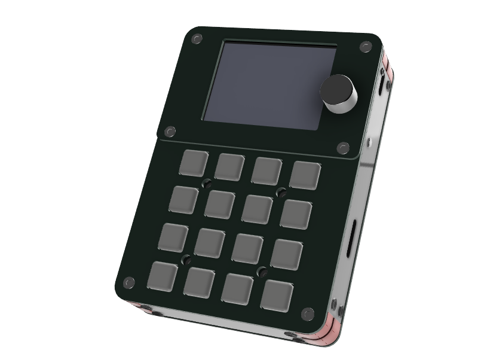

# CrossPad — ESP-IDF firmware

 [](../../actions/workflows/main.yml)   

The firmware for CrossPad, a 16-pad MIDI controller: an ESP32-S3 with an STM32 co-processor. It builds the board
support package, crosspad-core (portable logic) and crosspad-gui (the LVGL UI) into one image per board revision;
apps are separate repos added as git submodules, and the same app code also runs in the PC simulator.

## Quickstart

Needs ESP-IDF 5.5.4 or a newer 5.5.x (tested 5.5.5; 6.x is not supported) loaded in the terminal. Board v2 is PCB r20;
a v1 board (PCB r16/r19) uses `v1`, `build_v1`, `sdkconfig.v1`. The flash asks you to press **Allow**, then **Update**, on the board, which must already run CrossPad firmware (a blank board: [Flash over UART](https://crosspad.app/docs/how-to/flash-uart/)).

```bash
git clone --branch main https://github.com/CrossPad/platform-idf.git ~/CrossPad && cd ~/CrossPad
git submodule update --init --recursive
idf.py board --set v2
idf.py -B build_v2 -DSDKCONFIG=sdkconfig.v2 build
python3 tools/ota_flash.py
```

## Documentation

**https://crosspad.app/docs/** — [Start here](https://crosspad.app/docs/start-here/) · [Create an app](https://crosspad.app/docs/how-to/new-app/) ·
[Install apps](https://crosspad.app/docs/how-to/install-apps/) · [OTA update](https://crosspad.app/docs/how-to/ota-update/) ·
[Flash over UART](https://crosspad.app/docs/how-to/flash-uart/) · [HIL testing](https://crosspad.app/docs/how-to/hil-testing/) ·
[Architecture](https://crosspad.app/docs/concepts/architecture/) · [BSP API](https://crosspad.app/docs/reference/bsp/) ·
[CLI reference](https://crosspad.app/docs/reference/cli/) · [Troubleshooting](https://crosspad.app/docs/troubleshooting/).
Subsystem deep-dives: [docs/subsystems/](docs/subsystems/) (published on the site, e.g. [Firmware app](https://crosspad.app/docs/subsystems/firmware-app/)). Contributing — architecture, conventions, gotchas, the bench: [CLAUDE.md](CLAUDE.md).
Until the site has them, the hardware spec, the feature overview and the app-author APIs live in CLAUDE.md: [What This Is](CLAUDE.md#what-this-is), [Hardware Quick Reference](CLAUDE.md#hardware-quick-reference), [Event System](CLAUDE.md#event-system), [Pad Logic Handlers](CLAUDE.md#pad-logic-handlers) (PadManager), [REGISTER_APP Macro](CLAUDE.md#register_app-macro).

## License

The CrossPad firmware is free software under the **GNU General Public License
v3.0 or later** (`GPL-3.0-or-later`) — see [LICENSE](LICENSE).

Parts under their own terms:

| Path | License |
|---|---|
| `components/bsp/crosspad/`, `components/stm32_hal/`, `components/lcd_touch_ft6x36/`, `components/usb_device_uac/` | Apache-2.0 (from Espressif's components; see the file headers) |
| `components/arduino_midi_library/` | MIT (Francois Best) |
| `tools/webflasher/` (`dfu.js`, `dfuse.js`) | ISC (Devan Lai), `LICENSE.webdfu` |
| `components/ml_sample_stream_player_lib/` | **not covered by the GPL** — see below |
| submodules (`components/crosspad-*`, …) | their own repos' licenses |

### Audio engines

CrossPad's sample-streaming audio engine is a proprietary library © 2026
Marcel Licence, distributed in binary form under the CrossPad DSP Engines
Binary Redistribution License
([`components/ml_sample_stream_player_lib/LICENSE-blobs.txt`](components/ml_sample_stream_player_lib/LICENSE-blobs.txt)).
It is not covered by the GPL and its source code is not included.
Redistribution is permitted only as part of CrossPad and its forks. The
default build does not link it (it sits behind a Kconfig option, see
`components/crosspad-platform-idf/Kconfig`).

### No warranty, intended use

CrossPad is a musical instrument. This software is provided "as is", without
warranty of any kind (GPL-3.0 sections 15 and 16). It is not designed, tested
or certified for safety-critical use — medical, military, aviation,
automotive, nuclear or life-support systems — and should not be relied on
where a failure could cause injury, death or damage to property. Details:
[Legal](https://crosspad.app/docs/reference/legal/).
