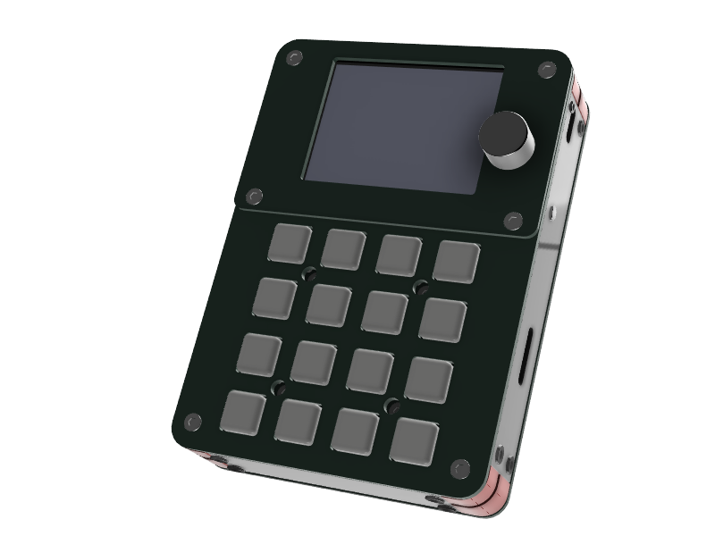
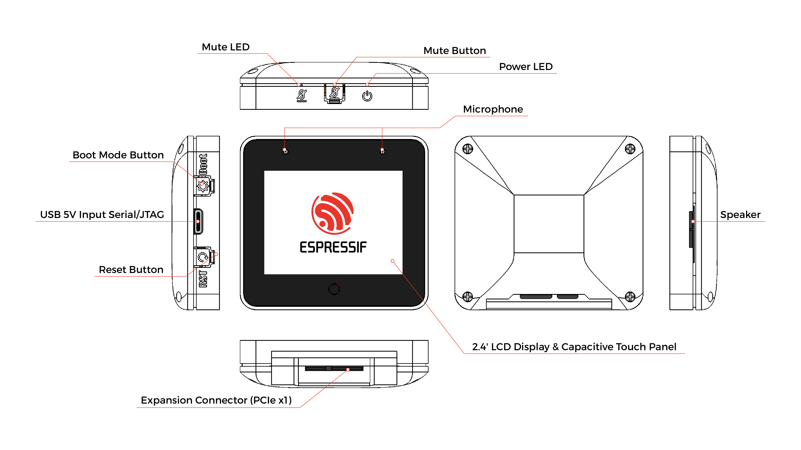

# BSP: CrossPad

| [BSP API reference](https://crosspad.app/docs/reference/bsp/) | [Headers](include/) | [ES8388 audio](AUDIO_ES8388.md) | [Performance monitor](PERFMON.md) | [Examples](examples/) |
| --- | --- | --- | --- | --- |

The API reference is generated from the headers in [`include/`](include/) on
the docs site; there is no hand-maintained API page in this folder any more.

## Overview

<table>
<tr><td>

CrossPad uses an ESP32-S3 with 8 MB of PSRAM and 16 MB of flash. It has a 2.4" 320x240 touch display, two ES8388 audio codecs with built-in stereo microphones and several audio in/out interfaces, an IMU, an SD card slot, and 16 analog pads plus an encoder for input. An STM32 co-processor scans the pads and runs the charger. The device is powered over USB-C or its battery and is programmed with ESP-IDF.

</td><td width="200" valign="top">
  
</td></tr>
</table>



## Capabilities and dependencies

From [`idf_component.yml`](idf_component.yml) and the sources (ESP-IDF >= 5.3 for this
component; the firmware itself is built with 5.5.x):

| Capability | Part / driver | Component |
|---|---|---|
| Display | ILI9341 driver with vendor init, SPI, 320x240 | `espressif/esp_lcd_ili9341` ^2.0.1 |
| LVGL port | | `espressif/esp_lvgl_port` ^2 |
| Touch | FT6x36, I2C | `lcd_touch_ft6x36` (in this repo) |
| Buttons / encoder | | `espressif/button` ^4, `include/indev/` |
| Audio | 2x ES8388 on I2S0 (master) + I2S1 (slave) | `espressif/esp_codec_dev` ~1.3.1, [`AUDIO_ES8388.md`](AUDIO_ES8388.md) |
| SD card | SDMMC (`bsp_sdmmc.h`) | ESP-IDF |
| IMU | ST LSM6DS3TR-C, own driver (`bsp_imu.cpp`) | none |
| Co-processor | STM32 over UART (+ I2C on Rev 2.0) | `stm32_hal` (in this repo) |

## Pinout macros

Each revision's pinout header defines the default pins of every peripheral:
`BSP_I2C_*`, `BSP_LCD_*`, `BSP_I2S_*`, `BSP_USB_*`, `BSP_SD_*` (SDMMC). Not every
interface exists on every board: check the capability macros (`BSP_CAPS_*` in
[`crosspad_s3.h`](include/crosspad_s3.h), `BSP_HAS_*` below) before you use
one, and branch on them rather than on `CONFIG_BSP_BOARD_REV_V*` directly. The
board identifier macro is `BSP_BOARD_CROSSPAD_S3`; `BSP_BOARD_REV_NAME` is
`"v1"` / `"v2"`.

## Audio quick start

The ES8388 quick start (I2C + I2S init, single and dual codec, volume and mute,
recording and playback, custom I2S configuration, ESP-ADF integration) is in
[`AUDIO_ES8388.md`](AUDIO_ES8388.md); a runnable version is
[`examples/es8388_example.c`](examples/es8388_example.c).

## Hardware Revisions

The BSP supports multiple PCB revisions of the CrossPad. The active revision is
selected at build time via Kconfig — the firmware is one binary per revision,
not a runtime probe.

### Selecting a revision

Day-to-day, don't set the Kconfig by hand: `idf.py board` resolves which
revision to build/flash (connected board first, then the last one remembered
in `crosspad.local.json`) and `idf.py board --set v2` remembers one
explicitly. `tools/crosspad_board.py` is the resolver; see
[docs/design/2026-09-14-board-selection-design.md](../../../docs/design/2026-09-14-board-selection-design.md)
for the full picture. The menuconfig / `sdkconfig.v*` route below is still
how a revision's Kconfig choice is defined — reach for it when adding a new
revision, not for switching between existing ones.

```
idf.py -B build_v2 -DSDKCONFIG=sdkconfig.v2 menuconfig
  → Component config
    → Board Support Package(CrossPad)
      → CrossPad PCB revision
        ( ) Rev 1.x (STM32 over UART, single sensor I2C bus)
        ( ) Rev 2.0 (UART for MIDI + dedicated STM32 I2C, ESP master)
```

Or set non-interactively in the revision's own config file (`sdkconfig.v1` /
`sdkconfig.v2` in the repo root each pin their choice):

```
CONFIG_BSP_BOARD_REV_V2=y
```

Switching revisions is incremental — only files that include pinout headers or
read `CONFIG_BSP_BOARD_REV_*` rebuild. Keep a separate build dir per revision
to avoid full rebuilds when bouncing between targets:

```bash
idf.py -B build_v1 -DSDKCONFIG=sdkconfig.v1 build
idf.py -B build_v2 -DSDKCONFIG=sdkconfig.v2 build
```

`build_*/` is gitignored so per-rev build dirs cohabit cleanly. Step by step,
with the expected output: [Build the firmware](https://crosspad.app/docs/start-here/2-first-build/).

### Available revisions

| Revision | Kconfig symbol           | Notes                                                        |
|----------|--------------------------|--------------------------------------------------------------|
| Rev 1.x  | `CONFIG_BSP_BOARD_REV_V1`| PCB r16 / r19 (`v1`). STM32 link is UART-only. Jack-detect via ADC on `GPIO8`. |
| Rev 2.0  | `CONFIG_BSP_BOARD_REV_V2`| PCB r20 (`v2`, the default for new boards). Adds dedicated STM32 I2C bus (ESP master) and EEPROM at `0x50`. Jack-detect moved into STM32 (no ADC). USB D+/D- swapped vs rev1. SDMMC pads exposed. SDA/SCL swapped vs rev1. |

The string form `CONFIG_BSP_BOARD_REV_STR` resolves to `"v1"` / `"v2"` and the
runtime symbol `BSP_BOARD_REV_NAME` carries the same value — useful for
About-screens, log banners, and OTA artifact naming.

### Pinout headers

Each revision lives in its own header under
[`include/pinout/`](include/pinout/):

```
components/bsp/crosspad/include/pinout/
├── pinout_v1.h
└── pinout_v2.h
```

[`crosspad_s3.h`](include/crosspad_s3.h) selects the right one with a single
`#if defined(CONFIG_BSP_BOARD_REV_V*)` chain. Headers are pure macros — no code,
no conditional functions. **Never add `#ifdef CONFIG_BSP_BOARD_REV_*` outside
this header**: keep revision diffs scoped to pinout + capability macros.

### Capability macros

Pinout headers also declare capability flags so consumers branch on what the
hardware can do, not on the revision number itself. Prefer these over
`#ifdef CONFIG_BSP_BOARD_REV_V2`:

| Macro                       | Meaning                                          |
|-----------------------------|--------------------------------------------------|
| `BSP_HAS_STM32_UART`        | UART link to STM32 co-processor wired            |
| `BSP_HAS_STM32_I2C`         | Dedicated I2C bus to STM32 (ESP master)          |
| `BSP_HAS_EEPROM`            | External I2C EEPROM populated                    |
| `BSP_HAS_JACK_ADC`          | Headphone-jack detect via `ADC_PIN` (else STM32) |
| `BSP_HAS_BACK_COVER_DETECT` | Back-cover GPIO populated                        |

Pins that are not routed on a revision are defined as `GPIO_NUM_NC` instead of
being omitted, so the `BSP_HAS_*` derivations stay regular.

### Adding a new revision

1. Copy `include/pinout/pinout_v2.h` to `include/pinout/pinout_v3.h` and fill
   in the GPIOs / I2C addresses / capability flags.
2. Add a Kconfig choice entry in [`Kconfig`](Kconfig):
   ```kconfig
   config BSP_BOARD_REV_V3
       bool "Rev 3.0 (description)"
   ```
   and extend `BSP_BOARD_REV_STR` with the matching `default "v3" if BSP_BOARD_REV_V3`.
3. Add the `#elif defined(CONFIG_BSP_BOARD_REV_V3)` branch in
   [`crosspad_s3.h`](include/crosspad_s3.h).
4. If the new rev removes a feature, mark its pin `GPIO_NUM_NC` — do not
   `#undef` the macro. The capability flag will fall to `0` automatically.
5. Add the `CONFIG_BSP_BOARD_REV_V3=y` branch to the board check in the
   top-level [`CMakeLists.txt`](../../../CMakeLists.txt) (it sets
   `-DCROSSPAD_BOARD=<n>`, so crosspad-core needs a matching board profile);
   any other revision is a `FATAL_ERROR` "selects no board revision".
6. Add `sdkconfig.v3` and teach `tools/crosspad_board.py` / `tools/ci_matrix.py`
   the new revision, then `idf.py -B build_v3 fullclean` and
   `idf.py -B build_v3 -DSDKCONFIG=sdkconfig.v3 menuconfig` to pick it up.
